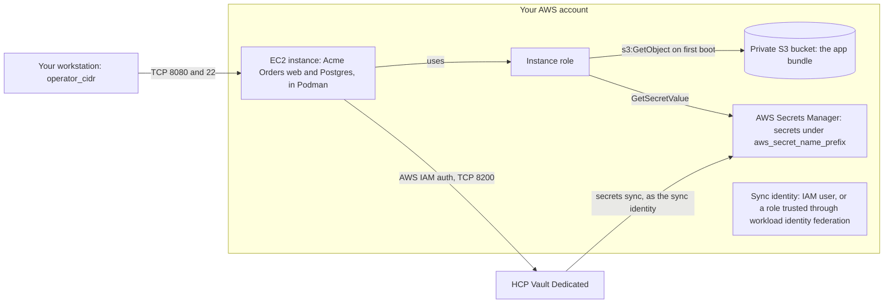

# Acme Orders lab: the AWS side

This repository builds the AWS half of a lab for HashiCorp Vault KV version 2 and Vault secrets sync to AWS Secrets Manager. Terraform starts one EC2 instance that runs Acme Orders, a small order-dispatch web app. It also creates the AWS identities that the app and Vault secrets sync use. You configure Vault by hand, as the companion guide shows: [the HCP Vault KV v2 and secrets sync PoC guide](https://hcp-vault-aws-kv-sync.vercel.app).

The app itself lives in a second repository, `acme-orders-vault-demo`. Terraform zips the app from your clone of that repository and the instance builds a container image from the zip on first boot.

## What it builds



- One EC2 instance running Acme Orders: the web front end and Postgres, both in Podman. The app serves plain HTTP on port 8080.
- A security group that lets in TCP 8080 and 22 from `operator_cidr` only. `0.0.0.0/0` is refused.
- An instance role. It can read Secrets Manager secrets in the chosen region whose names start with `aws_secret_name_prefix` (default `vault/app/`). It can also call `sts:GetCallerIdentity` for Vault AWS auth, and fetch the app bundle. Nothing else.
- A private, encrypted S3 bucket holding a zip of `app_source_dir`. The instance builds the image from it on first boot.
- The AWS identity that Vault secrets sync uses. This is an IAM user (`sync_auth = "iam_user"`, the default), or a role trusted through workload identity federation (`sync_auth = "wif"`). With `sync_auth = "none"`, Terraform creates neither, for accounts where you bring your own sync identity. The sync identity gets the actions that the Vault aws-sm sync documentation lists: create, update, delete, and tag. It also gets `DescribeSecret`, which Vault calls on every sync. All are limited to secrets in this account and region whose names start with `aws_secret_name_prefix`. With `wif`, the role trusts only tokens with your audience and with the subject that Vault sends for this sync destination. That subject is `vault_oidc_subject`, of the form `secrets-sync:<namespace path>:aws-sm:<destination name>`.

The repository also holds the Vault policy for the app, `policies/acme-orders-read.hcl`, and `scripts/sync-user-keys.sh`, which creates the sync IAM user's access key outside Terraform.

## Get both repositories

Clone this repository and `acme-orders-vault-demo` side by side, in the same parent folder:

```sh
git clone https://github.com/glimpsovstar/acme-orders-vault-demo.git acme-orders-vault-demo
git clone https://github.com/glimpsovstar/acme-orders-vault-lab.git acme-orders-vault-lab
cd acme-orders-vault-lab
```

The layout is then:

```text
<parent folder>/
  acme-orders-vault-demo/      the app: Containerfile, rotate, and the source
  acme-orders-vault-lab/       this repository
    policies/
    scripts/
    terraform/
```

Run every command in this README from the root of `acme-orders-vault-lab`.

## Before you start

- Terraform 1.14 or later, and AWS credentials for the target account.
- An AMI that your organisation approves for EC2, running RHEL 9 or Amazon Linux 2023. The lab does not pick an image for you.
- A public subnet with a route to the internet. The instance reaches HCP Vault, AWS APIs, and container registries.
- An EC2 key pair for SSH, unless your image provides access another way.

### AWS access you need

In the target account, you need permission to:

- create and delete an EC2 instance, a security group, and its rules, and read the subnet you name;
- create and delete an IAM role, its inline policy, and an instance profile, and pass the role to EC2;
- create and delete an S3 bucket, its settings, and objects in it;
- for `sync_auth = "iam_user"`, create and delete an IAM user, its inline policy, and its policy attachments, and create an access key for it;
- for `sync_auth = "wif"`, create and delete an IAM OIDC provider and a role;
- call `sts:GetCallerIdentity`.

To check the sync, you also need to list and read Secrets Manager secrets.

## Tests

The Terraform tests mock the AWS provider, so they create nothing and need no credentials. They build the real app bundle, so they need the app clone too. `terraform test` also reads `terraform/terraform.tfvars`, and some tests check the defaults, so run them here, before you create that file in the next section. If you already have one, move it aside first: `mv terraform/terraform.tfvars terraform/terraform.tfvars.bak`.

```sh
export TF_VAR_app_source_dir=../../acme-orders-vault-demo
terraform -chdir=terraform init -backend=false
terraform -chdir=terraform validate
terraform -chdir=terraform test
bash terraform/tests/archive_allowlist.sh
bash scripts/tests/test_sync_user_keys.sh
```

- `terraform test` checks the security group, the IAM policies for each `sync_auth` choice, the input validation, and that `app_source_dir` must hold a `Containerfile`.
- `archive_allowlist.sh` plants dummy `.env`, `.lab.env`, and `.pyc` files in the app folder, then builds the bundle. It checks that the bundle holds only the app's own files, and removes the dummies. It refuses to run if any of those files already exist. It uses the app folder in `TF_VAR_app_source_dir`, which it takes from the `terraform` folder when the path is relative, the same as `app_source_dir`.
- `test_sync_user_keys.sh` runs `sync-user-keys.sh` with a fake `aws` command. It checks that the key file has mode 0600, that nothing prints the key, and that a failure leaves no file behind.

## Inputs

Copy the example and fill it in. No secrets go in this file, and `.gitignore` keeps it out of Git.

```sh
cp terraform/terraform.tfvars.example terraform/terraform.tfvars
```

Point `app_source_dir` at the app clone. A relative path is taken from the `terraform` folder, so with the layout above the value is:

```hcl
app_source_dir = "../../acme-orders-vault-demo"
```

Required:

| Input | What it is |
|---|---|
| `image_id` | The AMI ID for the instance, such as `ami-0123456789abcdef0`. |
| `subnet_id` | A public subnet with a route to the internet. |
| `operator_cidr` | Your workstation's public IPv4 address as a `/32`, such as `198.51.100.7/32`. Only this range reaches the app and SSH. |
| `vault_addr` | The HCP Vault public address, such as `https://example.vault.hashicorp.cloud:8200`. |
| `app_source_dir` | Required: the default only works inside the original repository. The folder that holds the app's `Containerfile`: your `acme-orders-vault-demo` clone. The default, `../../app`, suits only a layout where the app sits in a folder named `app` beside this repository, so set it as shown above. |

Optional:

| Input | Default | What it is |
|---|---|---|
| `ssh_key_name` | `null` | An existing EC2 key pair name for SSH. |
| `vault_namespace` | `admin/kv-sync-poc` | The Vault namespace the app logs in to. |
| `vault_iam_server_id` | empty | The value of `iam_server_id_header_value` on the Vault AWS auth mount, if one is set. Usually the Vault host name, with no `https://` and no port. |
| `vault_iam_sts_region` | `us-east-1` | The region the app signs its Vault IAM login for. Keep the default unless the AWS auth mount uses a regional STS endpoint. |
| `aws_secret_name` | empty | The name of the synced secret in Secrets Manager. |
| `aws_secret_name_prefix` | `vault/app/` | The prefix of the synced secret names. A Vault sync name template of `vault/{{ .MountPath }}/{{ .SecretPath }}` gives `vault/app/<path>` for a mount named `app`. Sync and the instance role are limited to it. Keep it narrow in a shared account. |
| `region` | `ap-southeast-2` | The AWS region for the lab and the synced secret. |
| `name` | `acme-orders` | The name prefix for every resource. |
| `instance_type` | `t3.medium` | The EC2 instance type. The default has 4 GiB. With 2 GiB, the app, Postgres, and the operating system's package cache can run out of memory and stall the instance for several minutes. |
| `default_tags` | `Project = acme-orders-kv-sync` | Tags on every resource the AWS provider creates. |
| `aws_cli_image` | `public.ecr.aws/aws-cli/aws-cli:2.22.0` | The container image the instance uses to fetch the app bundle from S3. |
| `sync_auth` | `iam_user` | How Vault secrets sync signs in to AWS: `iam_user`, `wif`, or `none`. |
| `sync_user_name` | `acme-orders-sync` | `iam_user` only. The name of the sync IAM user. |
| `sync_user_permissions_boundary_arn` | `null` | `iam_user` only. A managed policy ARN to set as the sync user's permissions boundary. |
| `sync_user_policy_arns` | `[]` | `iam_user` only. Extra managed policy ARNs to attach to the sync user. The scoped inline sync policy is always added. |
| `vault_oidc_issuer` | `null` | `wif` only. The Vault plugin identity token issuer URL, `https://<host>:8200/v1/<namespace>/identity/oidc/plugins`. |
| `vault_oidc_audience` | `null` | `wif` only. The audience Vault puts in its identity tokens, such as `sts.amazonaws.com`. |
| `vault_oidc_subject` | `null` | `wif` only. The subject Vault sends for this sync destination. |

Your account may have rules for IAM users, such as a naming pattern, a permissions boundary, or required managed policies. Then set `sync_user_name`, `sync_user_permissions_boundary_arn`, and `sync_user_policy_arns` to match.

Values written into the instance's settings, such as `vault_addr`, `vault_namespace`, and `aws_secret_name`, are validated to a plain character set. A newline or shell text is refused at plan time.

## Run it

```sh
terraform -chdir=terraform init
terraform -chdir=terraform plan -out tfplan
terraform -chdir=terraform apply tfplan
terraform -chdir=terraform output
```

First boot takes a few minutes. It installs Podman, builds the app image, and starts the `acme-orders` systemd unit. The log is `/var/log/acme-orders-setup.log` on the instance.

## Outputs

| Output | Use |
|---|---|
| `app_url` | Open it in a browser from your workstation. Plain HTTP, reachable only from `operator_cidr`. |
| `instance_role_arn` | Set it as `bound_iam_principal_arn` on the Vault AWS auth role. |
| `aws_secret_name_prefix` | Synced secret names must start with this. |
| `sync_principal` | The IAM user name with `iam_user`, the role ARN with `wif`, or null with `none`. |

No output holds a key.

## The Vault policy for the app

`policies/acme-orders-read.hcl` grants `read` on `app/data/db` and `app/metadata/db`, and nothing else. Write it in the namespace the app logs in to:

```sh
vault policy write acme-orders-read policies/acme-orders-read.hcl
```

## Access key for the sync IAM user

Terraform never creates the key, so the key is never in state. Create it once, into a new file with mode 0600:

```sh
scripts/sync-user-keys.sh "$(terraform -chdir=terraform output -raw sync_principal)" ~/.kv-sync/aws-sm-keys.json
```

The file is JSON with `access_key_id` and `secret_access_key`, so Vault can read it directly with `@file`. Delete it once Vault has the key. `terraform destroy` deletes the user and its keys.

## Change the AWS secret name, or another app setting, later

The host in the `ssh` commands below is the address in the `app_url` output. Print it with:

```sh
terraform -chdir=terraform output -raw app_url | sed -E 's#^https?://##; s#:[0-9]+$##'
```

The instance reads `aws_secret_name` and `vault_iam_server_id` on first boot only. To change a setting later, set it on the instance. The instance is not rebuilt:

```sh
ssh ec2-user@<host from app_url> sudo /usr/local/bin/acme-orders-set KVS_AWS_SECRET_NAME vault/<name>
```

This updates `/etc/acme-orders/acme.env` and restarts the web container. The database keeps running. The same command changes `VAULT_ADDR`, `VAULT_NAMESPACE`, `AWS_REGION`, `KVS_IAM_SERVER_ID`, and `KVS_IAM_STS_REGION`.

Terraform ignores later changes to user data and to `image_id` on the instance, so a changed variable never stops or replaces it.

## Update the app code

`terraform apply` uploads a new bundle when the files in `app_source_dir` change. Then rebuild and restart on the instance:

```sh
ssh ec2-user@<host from app_url> 'sudo /usr/local/bin/acme-orders-build && sudo systemctl restart acme-orders'
```

## Tear down

```sh
terraform -chdir=terraform destroy
```

This deletes the instance, the bucket with its bundle, the roles, and the sync identity with its keys. The Vault configuration is yours to remove.

## Licence

This repository is licensed under the Mozilla Public License 2.0 (MPL-2.0). See [LICENSE](LICENSE).
